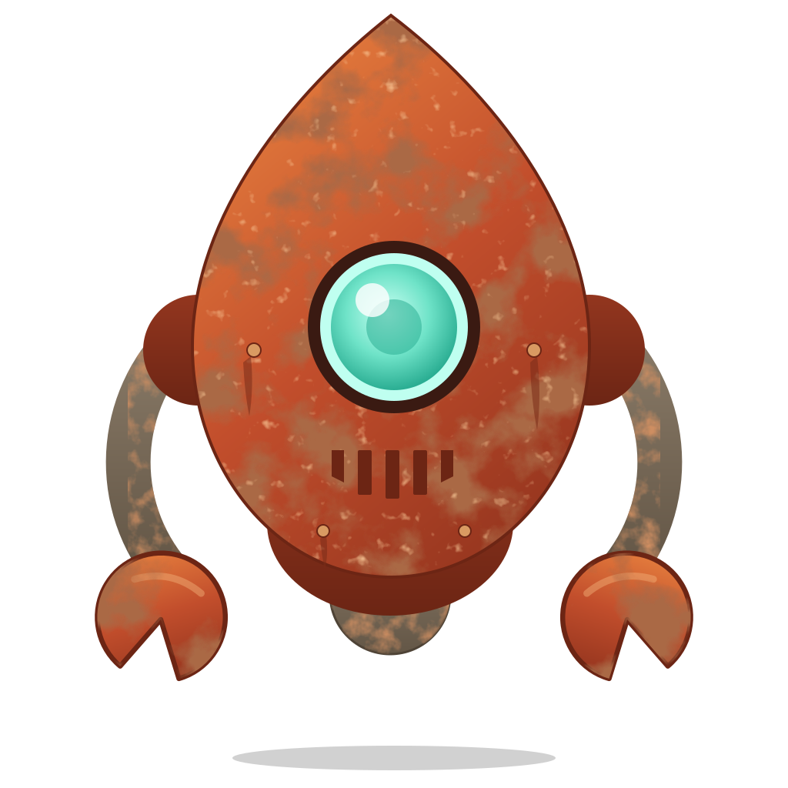
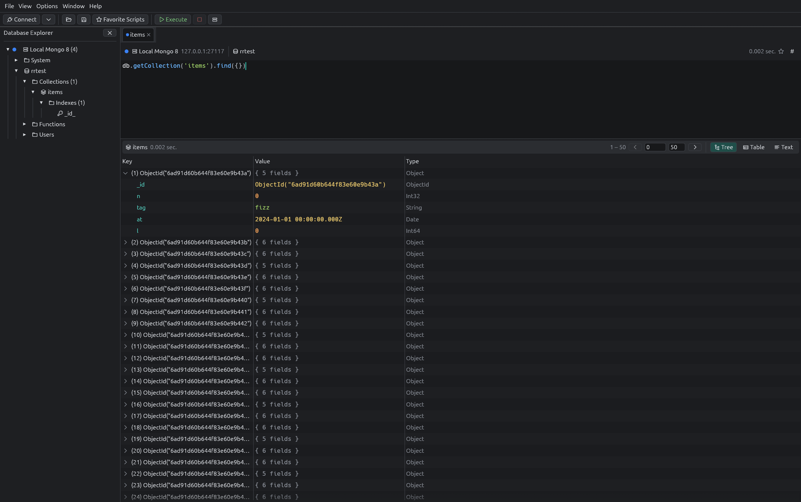
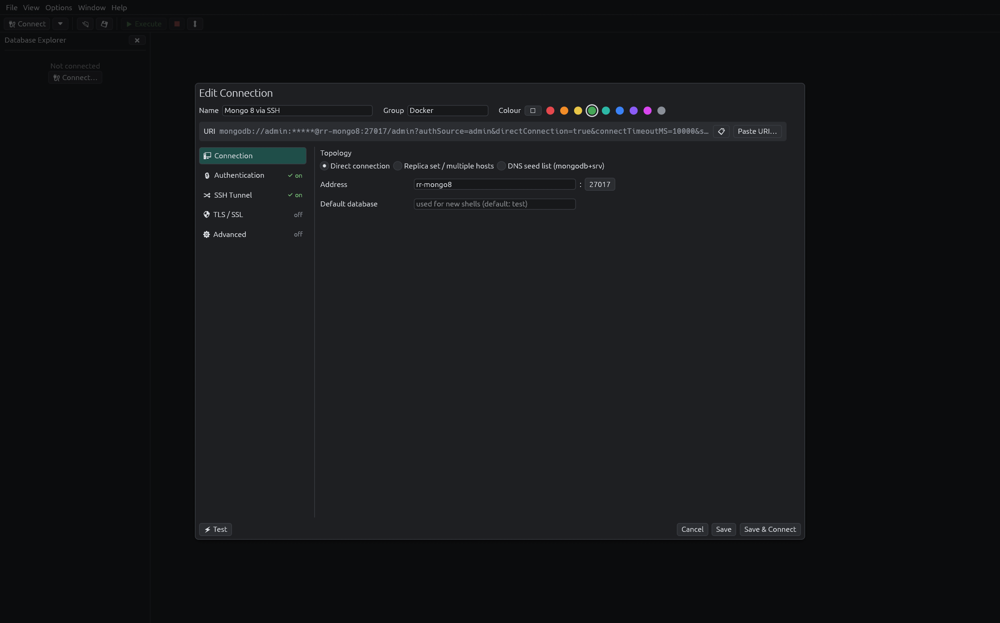
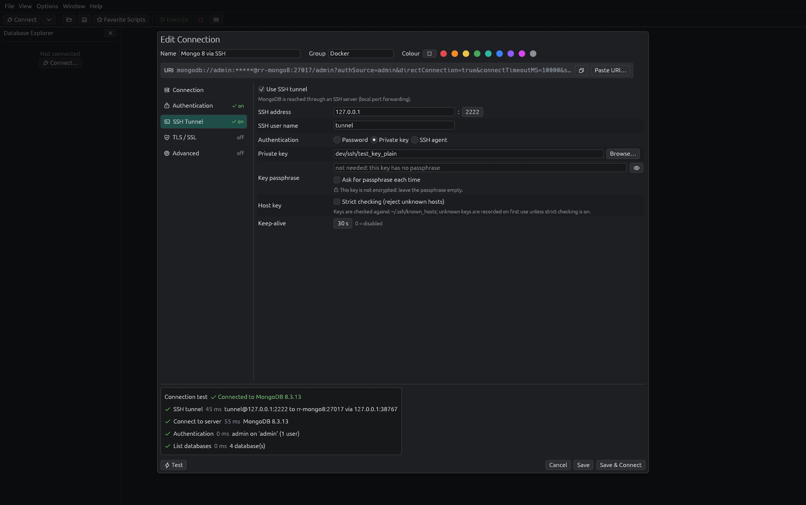
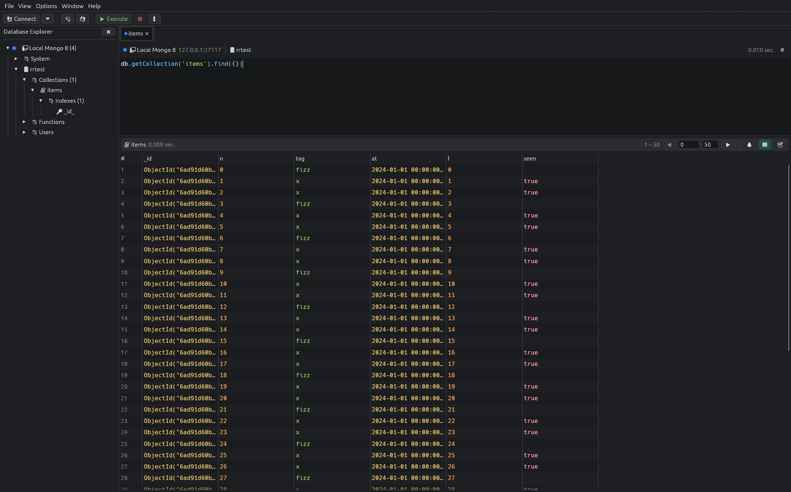
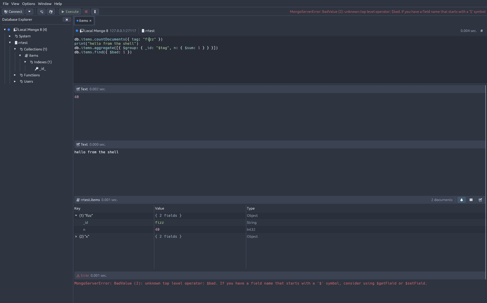

<p align="center">
  
</p>

<h1 align="center">Rustyrobo</h1>

<p align="center">
  A fast, native MongoDB GUI written in Rust — a port of Robomongo / Robo 3T.
</p>

<p align="center">
  <a href="https://github.com/Tatayoyoh/rustyrobo/actions/workflows/ci.yml"></a>
  
  
  
  <a href="LICENSE"></a>
</p>

<p align="center">
<a href="https://tatayoyoh.github.io/rustyrobo/">Website</a>
</p>



## Why

Robo 3T (formerly Robomongo) was the go-to lightweight MongoDB shell-centric GUI, but it is no longer
maintained.

rustyrobo keeps what made Robomongo great — the same layout, the same workflow, the same shortcuts —
and rebuilds it as a single native Rust binary that supports current MongoDB versions.

## Features

**Like Robomongo**
- Same interface: explorer, query tabs, tree / table / text views, shortcuts
- Embedded mongo shell
- Easy document editing
- Collection, index, user and function management

**Plus**
- MongoDB 3.6 → 8.x, shell included (no 4.2 limit)
- Reliable SSH tunnels: agent, encrypted keys, host-key checks
- Improved connection manager and redesigned connection editor
- Field-name and operator autocompletion
- Real colour themes
- Native single binary, light on resources

## Install

Build from source (Rust 1.88+):

```sh
git clone https://github.com/Tatayoyoh/rustyrobo.git
cd rustyrobo
cargo build --release
./target/release/rustyrobo
```

Linux needs the usual windowing libraries (X11 or Wayland, `libxkbcommon`); file dialogs use the
XDG portal or GTK.

## Development

```sh
cargo test                                   # unit tests
dev/ssh/gen-keys.sh && docker compose -f dev/docker-compose.yml up -d --wait
RR_LIVE=1 cargo test --test live --test ui -- --test-threads=1   # e2e: real servers, SSH, UI
```

Settings are stored in `~/.config/rustyrobo/settings.json` (override with `RUSTYROBO_CONFIG_DIR`).

## Screenshots

| Connection editor | SSH test |
|---|---|
|  |  |
| **Table view** | **Nord theme** |
|  |  |

## License

Apache-2.0. rustyrobo is an independent rewrite (no Robomongo code is reused) and is not affiliated with Studio 3T or MongoDB, Inc.
